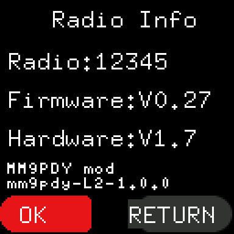

# Baofeng UV-5R Mini (MM9PDY)

<!-- variant-status:start -->
> **Availability by radio:** NRF, Firmware V0.27, Hardware V1.7: latest release 1.1.0. NRFB, Firmware V0.04, Hardware V1.7: latest release 1.1.0.
<!-- variant-status:end -->

A small, free modification of the Baofeng UV-5R Mini's own firmware. It adds zones (named groups of channels for
each side of the radio, each with its own scan list and channel order), nuisance delete while scanning, a
programmable centre button, a Quick Access list and three watch modes, and names the build in Radio Info. Everything else works as the maker made it. It is written to the radio with
[Codeplug Studio](https://codeplug.mm9pdy.net) and the radio's programming cable.

Release 1.1.0 is for the **UV-5R Mini** with Hardware `V1.7` and either Firmware `V0.27` with suffix `NRF`, or
Firmware `V0.04` with suffix `NRFB`. Check Firmware and Hardware in **MENU > Radio Info** and the suffix on the hold-8 power-on screen below. Other Minis
are not supported yet; the UV-5RM and UV-5RH are different radios.

## What it does

| Feature | What you get | Page |
|---|---|---|
| Zones | Each side of the radio works with a named group of channels; Up and Down step only through it, in the order set in Studio | [zones.md](zones.md#choosing-a-zone) |
| Zone line | The idle screen shows each side's zone under the channel name | [zones.md](zones.md#seeing-each-sides-zone) |
| Zone scan | A scan in a zone visits that zone's own scan list, the channels marked **Scan in this zone** in Studio | [zones.md](zones.md#scanning-a-zone) |
| Nuisance delete | Skip a busy channel temporarily while scanning | [zones.md](zones.md#skipping-a-nuisance-channel) |
| Centre button | Choose what a tap and a hold of the blue centre button do; the flashlight switches on and off | [centre-button.md](centre-button.md) |
| Quick Access | A short list, last in the menu or on the centre button: scan, flashlight, monitor, watch mode | [quick-access.md](quick-access.md) |
| Watch modes | Single watch (one channel, big digits, both PTTs on it), Dual Watch or Dual Monitor | [watch-modes.md](watch-modes.md) |
| Build name | The power-on screen and Radio Info show `MM9PDY mod` and which MM9PDY build the radio runs | [install.md](install.md#3-check-it-worked) |

## Pages

| Page | What it is for |
|---|---|
| [install.md](install.md) | Putting it on the radio with Codeplug Studio |
| [zones.md](zones.md) | Zones: setting them up, choosing one, the zone line, scanning |
| [centre-button.md](centre-button.md) | The centre button's tap and hold, and the flashlight |
| [quick-access.md](quick-access.md) | The Quick Access list: opening it and its four rows |
| [watch-modes.md](watch-modes.md) | Single watch, Dual Watch, Dual Monitor: what each does and how to choose |
| [back-to-stock.md](back-to-stock.md) | Putting the maker's firmware back |
| [recovery.md](recovery.md) | If an update stops half way, or the radio does not start |

## Read this first

- **It is a risk.** Writing firmware can leave a radio that does not start. There is a way back for most failures
  ([recovery.md](recovery.md)), but a few need the radio repaired with the case open. You accept the risk, and it is
  your radio. Nothing here is a promise.
- **Two kinds of UV-5R Mini only.** Release 1.1.0 is for radios that came with one of these exact combinations:

  | What | Must read | Where to see it |
  |---|---|---|
  | Firmware | `V0.27` or `V0.04` | **MENU**, then **UP** to the last item, **Radio Info**, then **MENU**: the line `Firmware:V0.27` or `Firmware:V0.04` |
  | Hardware | `V1.7` | The same screen: the line `Hardware:V1.7` |
  | Suffix | `NRF` with `V0.27`, `NRFB` with `V0.04` | A hidden screen: switch the radio off, hold **8** while you switch it on, and for about a second it shows `5RMINI NRF` or `5RMINI NRFB` |

  The suffix screen goes by quickly. Switch off and do it again if you miss it, or film it with a phone. Release your
  finger from **8** whenever you like; the radio carries on starting normally.

  Any other combination (for example `5RMINI NRF` with Firmware `V0.04`) is not supported by 1.1.0. Codeplug Studio
  stops and writes nothing. Do not try to work round it.
- **Studio can't read these from a stock radio.** On a first install it asks you for the suffix and the Hardware line,
  so read them off the radio before you start; never guess. A radio already running an MM9PDY build tells Studio
  itself.
- **Writing firmware does not touch your channels.** Channels, settings and calibration stay as they are. Take a
  backup with Codeplug Studio before you start anyway.
- **Keep a way back.** Keep the stock firmware file (see [install.md](install.md#what-you-need)) and the release's to-stock file
  ([back-to-stock.md](back-to-stock.md)).
- **Release candidates** (versions ending `-rc.1`, `-rc.2`, ...) are for testing and may have faults.

After the MM9PDY firmware is installed, Radio Info shows two small lines under the stock ones: `MM9PDY mod`, then
the build name, for example `v0.27-NRF-1.1.0`. The power-on screen shows the same two lines along its bottom edge.
On a V0.27 radio, releases up to 1.0.0 show the build name alone. The Firmware and Hardware lines and the hold-**8** screen stay the
same as before.

A build name starts with the stock firmware it is made for, then the suffix, then the version: `v0.27-NRF-1.1.0` is
version 1.1.0 for a `5RMINI NRF` radio with firmware V0.27, and a release candidate ends `-rc.1` to `-rc.9`. Each supported combination gets its own file with that name. The same version number means
the same features for you on every supported combination; these pages say when one is behind or ahead. The 1.0.0
release for V0.27 radios was named `mm9pdy-L2-1.0.0`, before this scheme.

