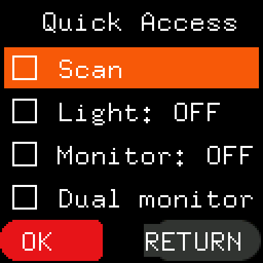

# Quick Access

<!-- variant-status:start -->
> **Availability by radio:** NRF, Firmware V0.27, Hardware V1.7: latest release 1.1.0. NRFB, Firmware V0.04, Hardware V1.7: latest release 1.1.0.
<!-- variant-status:end -->

Quick Access is a short list of things you switch often: **scan**, the **flashlight**, **monitor** and the
**watch mode**.
It is the last item of the menu, and the blue centre button can open it with one press.

This needs a MM9PDY release that lists Quick Access in its notes, on one of the supported radios (see
[the first page](README.md#read-this-first)).

## Opening it

- **From the menu:** press **MENU**, then **UP** once. The cursor wraps to the last item, **Quick Access**, shown with
  a microphone icon. Press **MENU**. (When the codeplug has zones, **Zones A** or **Zones B** is the item just before
  it.)
- **From the centre button:** set Radio Set › **PRESS SK2** (a tap) or **HOLD SK2** (a hold) to **QUICK ACCESS**
  ([centre-button.md](centre-button.md#choosing-what-the-button-does)). From the idle screen the button then opens
  the list straight away. Anywhere else, such as in the menu, during a scan or on FM radio, it beeps and does nothing.
  With the keypad locked it gives the lock beep.

## The list

Move with **UP** and **DOWN** and press **MENU** on a row. The radio does it and the list stays open, the row showing
what is on now. **Scan** and **Monitor** close the list. **EXIT** closes the list: back to the menu,
or straight to the idle screen when the centre button opened it.

| Row | What it does |
|---|---|
| **Scan** | Closes the list and starts a scan, exactly as holding **#** does. In a zone it scans that zone's channels. |
| **Light: ON** / **Light: OFF** | Switches the flashlight on or off. The row shows what the flashlight is doing now. |
| **Monitor: OFF** | Closes the list and opens the squelch, so you hear the channel even with no signal. It stays open until you press any key; that key only closes it. Nothing on the screen shows monitor is on, as with the maker's monitor. |
| **Single watch** / **Dual watch** / **Dual monitor** | Shows the [watch mode](watch-modes.md) in use. **MENU** opens the list of modes; pick one and press **MENU** to come back with the new mode shown (**EXIT** comes back without changing it). It is the same setting as Radio Set › Watch Mode, saved and kept when the radio is switched off. |

The rows are in English when the menu is in Chinese too.
