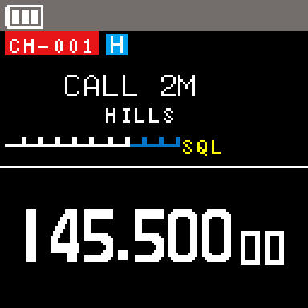

# Watch modes

<!-- variant-status:start -->
> **Availability by radio:** NRF, Firmware V0.27, Hardware V1.7: latest release 1.1.0. NRFB, Firmware V0.04, Hardware V1.7: latest release 1.0.0.
<!-- variant-status:end -->

The radio has two sides, A and B. The watch mode decides how many of them you see and hear:

| Mode | You see | You hear | The PTT buttons |
|---|---|---|---|
| **Single** | One channel, its frequency in big digits underneath | That channel only | Both transmit on the channel you see |
| **Dual Watch** | Both sides; the one not in use is grey, with a crossed-out speaker | The side in use only | Each transmits on its own side, as before |
| **Dual Monitor** | Both sides, with the dual-watch icon at the top | Both sides, in turn | Each transmits on its own side, as before |

Dual Watch and Dual Monitor are the maker's Dual Watch OFF and ON, unchanged.

This needs a MM9PDY release that lists the watch modes in its notes, on one of the supported radios (see
[the first page](README.md#read-this-first)).

## Choosing the mode

- **From the menu:** **MENU**, **Radio Set**, then **Watch Mode** (where Dual Watch used to be). The mode in use is
  highlighted. Pick one and press **MENU**; the radio says "Save OK".
- **From Quick Access:** the last row shows the mode in use (**Single watch**, **Dual watch** or **Dual monitor**).
  Press **MENU** on it, pick a mode and press **MENU**: you are back in Quick Access with the new mode shown. **EXIT**
  goes back without changing it. See [quick-access.md](quick-access.md).

The mode is kept when the radio is switched off. The labels are in English when the menu is in Chinese too.

## Single watch

- **A/B** switches which side you see. **UP**, **DOWN**, **V/M**, scanning and zones work on it as usual, and its zone
  shows under the channel name.
- Underneath is the frequency in big digits. When the top already shows the frequency (the FREQ display, or VFO
  mode), the bottom stays empty.
- Either PTT transmits on the channel you see.
- Only that channel is received.

If you put the maker's firmware back, a radio left in Single shows Dual Watch.
