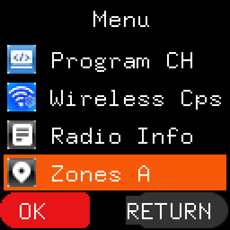
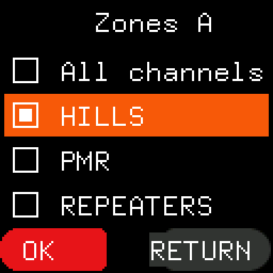
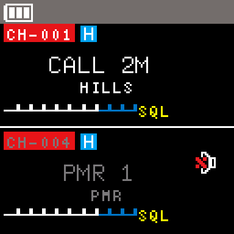
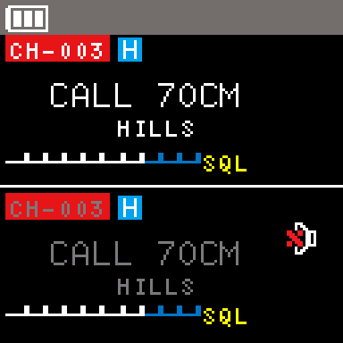
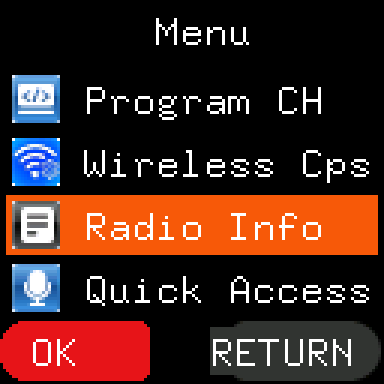

# Zones

<!-- variant-status:start -->
> **Availability by radio:** NRF, Firmware V0.27, Hardware V1.7: latest release 1.1.0. NRFB, Firmware V0.04, Hardware V1.7: latest release 1.1.0.
<!-- variant-status:end -->

Zones let each side of the radio work with a named group of channels instead of all of them. With side A in a zone
called "HOME", Up and Down on side A visit only HOME's channels, while side B can use another zone or all channels.

Zones need the MM9PDY firmware for the UV-5R Mini, release 1.0.0 or later (scan lists, zone order and nuisance
delete need 1.1.0), which is for radios that came with Hardware `V1.7`
and suffix `NRF` with Firmware `V0.27`, or suffix `NRFB` with Firmware `V0.04` (see [the first page](README.md#read-this-first)).

## Setting up zones

Zones are written by **Codeplug Studio**, as part of the codeplug, when the radio is the MM9PDY Mini target:

- up to 24 zones;
- each with a name of 1 to 12 characters (letters, digits, spaces and punctuation);
- each holding any of the 999 channel numbers, and a channel may be in more than one zone.

Studio writes the channel order for each zone with the codeplug. The radio restarts after the write and reads the zones as it starts.

## Choosing a zone

1. On the idle screen, make the side you want active (A/B) and put it in channel mode (V/M).
2. Press **MENU**, then **UP** twice: the cursor wraps to the last item, [Quick Access](quick-access.md), then moves
   up to **Zones A** (or **Zones B** when side B is active), shown with a location-pin icon.

   

3. Press **MENU**. The list shows **All channels**, then every zone that has at least one channel in it. The side's
   current zone is highlighted, and the cursor starts on it.

   

4. Move with **UP** and **DOWN** and press **MENU** to choose. The radio goes back to the idle screen with the side
   in that zone. **EXIT** leaves the list without changing anything.

When you choose a zone, the side stays on its channel if it is a live member of that zone. Otherwise it goes to
the live channel it last used in that zone since the radio was switched on, or the first live member in zone order.
Choosing **All channels** keeps the channel. There is no voice prompt.

**Checked on a radio with the 1.0.0 release candidate:** both sides returned to their zones and channels after a
power cycle.

The Zones item is not shown while the active side is in VFO (frequency) mode, or when the radio has no zones. The
menu is then the same as the standard firmware's. In the Chinese menu the item and the zone names are shown in the
same Latin letters.

## Seeing each side's zone

**Checked on a radio with the 1.0.0 release candidate:** the zone line on both sides in NAME and FREQ modes.

When the display mode (Program CH › CH-MDF) is **NAME**, the idle screen shows each side's zone in small letters
just under the channel name: the zone's name, or **All channels** when the side is not in a zone. Like the channel
name, it is white on the active side and grey on the other. It changes as soon as the zone does: after choosing a
zone, after Up or Down, and after A/B.

The zone is not shown:

- in **FREQ** or **CH** display mode, where the large digits fill that part of the screen;
- on a channel without a name, which shows its frequency instead (as the standard firmware does);
- while the side is in VFO (frequency) mode;
- when the radio has no zones.

The screen is then the same as the standard firmware's.

## Using a zone

- **Up and Down** (and holding them) step only through the zone's channels in the order set in Studio, wrapping round
  at either end.
- **Typing a channel number** still reaches any channel, in the zone or not. The next Up or Down goes to the zone's
  nearest channel in the zone above or below it by channel number, then follows the zone order.
- **Deleting channels** (Program CH › CH-Delete): if you delete the side's channel, it moves to the zone's next
  channel. If a zone loses its last channel, the side goes to All channels, and the zone is no longer listed until a
  channel is put back in it.

With older codeplugs or damaged order or scan-set data, channels follow channel-number order. If a zone’s order
does not fit in the codeplug, that zone also follows channel-number order.

**Checked on a radio with test builds of 1.1.0**, on a V0.04 and a V0.27 radio.

## Scanning a zone

**Checked on a radio with the 1.0.0 release candidate:** scan stopped on a zone channel with SCAN ADD, did not
visit an outside channel, scanned a zone with no SCAN ADD channels, and kept the channel when stopped. Scan lists
(**Scan in this zone**, new in 1.1.0) are checked in the emulator, and on a radio only in general use of the 1.1.0
release candidate.

When the active side is in a zone, a scan (started as usual, with the key set to scan) visits the live channels
marked **Scan in this zone** in Studio. At least two must be available to start. If the scan set did not fit in the
codeplug, scan visits every live channel in the zone.

With an older codeplug or damaged scan-set data, scan visits channels marked SCAN ADD, or every live channel in the
zone if none is marked. In that case one live channel is enough to start. A signal stops the scan only on a visited
channel. Stopping keeps that channel, and the radio remembers it with the zone. Up and Down during a scan change
direction, following the zone order in either direction. If scan starts on a channel outside the zone, it listens
there first, then moves to the nearest eligible channel above it by channel number and follows the zone order.

In **All channels**, scan works as in the standard firmware: every channel with SCAN ADD.

## Skipping a nuisance channel

**Checked on a radio with a test build of 1.1.0.**

While a channel scan is stopped on a signal, or during the pause after it, hold the side key (SK1) to skip that
channel. The scan moves on and skips it until you switch the radio off. If it is the last channel available to the
scan, the radio beeps and keeps it instead. This also works with the keypad locked and when using All channels or no
zones.

Skipped channels stay skipped if you stop and restart the scan or change zones. If every eligible channel is skipped
when a scan starts, those channels are restored; skips outside that scan remain. Editing a channel clears its skip;
programming the radio clears all skips. Outside a scan the side key works as usual for Monitor.

## A codeplug without zones

If the codeplug has no zones, or the radio finds the zone data damaged, zone behaviour follows the standard
firmware: no Zones item, Up and Down step through every channel, and scan uses SCAN ADD as usual, with nuisance delete available as described above.

## Factory reset

**Radio Set › Reset › Reset All** erases the channels and settings, but not the zones. After the next power-on the
zones are back. A zone that lists channel numbers the reset fills with its default channels holds those channels
again.
