# What the mods do

> **Release candidate docs: 1.2.1-rc.1** These pages describe a release candidate that is still being tested. For the current release, see [these docs](../../anytone-at-d890uv/features.md).

Each mod is described here as it behaves on the radio, with how to turn it on and what it does not do. Which release has
which mod, and what has been checked on a real radio, is in each release's notes (Codeplug Studio shows them when you
pick a release).

Most mods do nothing until you assign a key to them in the CPS. With no keys assigned, the radio behaves as stock,
apart from the release name on the power-on screen, the star-key timeslot toggle and, from 1.2.0, the channel screen
in the single display (below).

> **Changed in 1.2.0: the channel screen with one channel on screen (CPS "sub channel" off), for everyone.** Every
> channel now shows three lines, whether or not any keys are assigned: the channel name; the talk group (digital) or
> the receive frequency (analogue); and the zone name on a small centred line underneath. Before, line 2 showed the
> zone name (or alternated it with the contact) and analogue and digital channels looked different. With both channels
> on screen nothing changes unless TG next / previous is assigned.

## 1. Setting up keys in the CPS

The mods reuse three of the radio's stock key functions. The **CPS still shows the stock names**, so you pick them by
their old name. The radio's own menu (Menu > Radio Set > Key Func, English menu language) shows the new names.

| Mod | Pick this in the CPS key list | The radio's Key Func menu shows | Stock function it replaces |
|---|---|---|---|
| TG previous | Record Switch | TG Previous | Record Switch |
| TG next | Record | TG Next | Record |
| Quick filters menu | Priority Zone | Quick Filters | Priority Zone |
| S-meter screen (optional) | Satellite Predicting | S-Meter | Satellite Predicting |

You can assign them to the short or long press of PF1, PF2, PF3, P1 or P2. A common set-up: P1 = TG next, P2 = TG
previous, PF3 = Priority Zone (quick filters). Write the codeplug to the radio as usual.

While the mods are on the radio, the stock Record Switch, Record and Priority Zone functions are not available. The
S-meter screen key (section 10) is optional: the screen also opens from the menu, so assign it only if you want a key.
It replaces the stock Satellite Predicting function, which the D890 does not use for anything else.

## 2. Independent talk groups

Pick the talk group you talk on separately from the channel. Program a repeater once, as one channel, and put the talk
groups you use on it in the channel's RX group list. Then:

- **TG next** steps through the channel's own contact, then each talk group in the RX group list, in list order, and
  wraps round. **TG previous** goes the other way.
- **PTT** transmits to the talk group you picked.
- **Line 2** of the channel screen shows the picked talk group, under the channel name.
- The **zone name** stays on screen. With one channel on screen it is on a small, centred line of its own under the
  talk group. Every channel looks the same there: channel name, then the talk group (digital) or the frequency
  (analogue), then the zone, whether or not TG next / previous is on a key. Line 2 shows the receive frequency, also
  while you transmit on a split channel. With the CPS display mode set to frequency, line 1 already shows it, so line
  2 shows the channel name instead. With both sides on screen (CPS "sub channel" on) it follows the talk group on line 2, as
  `Talk group | Zone`; when that is too long for the line it scrolls, like a long channel name. The other side's
  line (the sub side, dual watch) shows that side's own pick the same way, as `Talk group / Zone`.
- The pick is **kept per channel** while the radio is on. Change channel and come back: your pick is still there.
  Switching off clears every pick. Nothing is saved to the codeplug.
- The timeslot a picked talk group is sent on, first match wins: the slot set for that member in the RX group list
  (see below), then a name ending in `TS1` or `TS2` (for example `Scotland TS2`), then the channel's own timeslot. The
  quick filters menu's **TG slot** row (Channel) turns the first two off. A short `*` overrides all of these until the
  next TG next / previous, channel change or zone change (see the star-key timeslot toggle below).
- The red **T1 / T2 badge** next to `CH-n` shows the timeslot in use: a picked talk group's slot when it has one,
  otherwise the channel's. In the dual display, each side's badge follows that side's talk group.
  (Checked in an emulator; not yet checked on a radio.)
- **A timeslot per RX-list member** is set in Codeplug Studio (the MM9PDY target writes it with the list). The radio
  only reads it; there is no menu to set it. It should be lost when the list is written by the official CPS or by Studio's
  stock target (not yet checked on the radio), and is expected to stop applying after you edit that list's members on
  the radio (the whole list's slots are then ignored and the name suffix and channel slot apply).
- **During a call** the same keys still work. Press TG next or TG previous while a call is on the receive screen and the
  radio steps, goes back to the channel screen and shows the new talk group on line 2. With the quick filters menu's
  RX match set to TG, the call you stepped away from should stop being heard (not yet confirmed on a radio). With RGL or Any the call may carry on,
  but the next time you transmit it goes to the talk group you picked. It works for group and private calls. It does
  nothing while the sub side (dual watch) is the one receiving.
- A channel with no RX group list shows "No RX list" and nothing changes.
- A digital channel with **no contact** (the CPS's "None", or a contact that points at a deleted talk group) starts on
  the **first talk group in its RX group list** instead of the first talk group in the radio. PTT, line 2 and what you
  hear all follow. The cycle for such a channel is just the list: the first talk group is not offered twice. A channel
  with no contact and no RX group list behaves as stock. A contact that is set, including the first talk group in the
  radio, is never changed. This needs TG next or TG previous assigned to a key, like the rest of this section (except
  the single display's channel screen, which is the same for everyone).
- **Stopping a zone scan on a call** picks the talk group you just heard, so you can reply straight away. Stop the
  scan (any key, or Menu) while it is paused on a digital channel during or just after a group call:
  - a talk group in that channel's RX group list, or its own contact, becomes the channel's pick, as if you had stepped
    to it;
  - any other talk group (heard with RX match Any or digital monitor) is used **for now only**: line 2 shows its name
    if it is in the radio's talk-group list, otherwise its ID, and PTT goes to it on the timeslot it was heard on
    (a `TS1` / `TS2` name, or TG slot Channel, still decide the slot). TG next / previous, or changing channel, goes
    back to the channel's own pick.

  A stop that goes back to the start channel, a private call, an analogue channel and list scan change nothing.

With TG next pressed twice on a channel whose RX group list holds three talk groups, line 2 shows the third one:

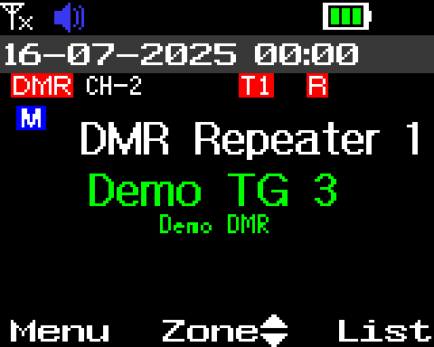

Limits:

- Digital memory channels only. Not in VFO mode, not while scanning, and only on the channel screen or the receive screen of a call.
- The main side only. To change the sub side's (dual watch) talk group, make it the main side with Main Channel Switch
  (key function 19), step, and switch back; each switch saves the radio's settings, as in stock. Stepping is ignored
  while the sub side is receiving.
- Hot keys, last-call reply and talkback after a received call use their own target for that call. Your pick comes
  back at the next channel change or step.
- The name suffix is matched loosely: the last three letters, ignoring case, so `xTS2` counts too.
- "No RX list" is in English whatever the menu language.
- Up to 64 talk groups per RX group list (the stock limit).

## 3. Star-key timeslot toggle

On the channel screen of a digital channel, a **short press of `*`** switches the timeslot the radio is using to the
other one, TS1 or TS2. The radio shows "TS 1 Selected" or "TS 2 Selected" for the slot it now uses, and the T1 / T2
badge follows.

- `*` always wins: it switches from the slot in use, even when a picked talk group has its own timeslot (from its RX
  group list, a `TS1` / `TS2` name suffix, or the slot a call was heard on after a scan stop), and with the quick
  filters menu's **TG slot** set to Channel.
- It lasts until the next TG next / previous, channel change or zone change. After TG next / previous the new talk
  group's own timeslot applies (a talk group without one uses the channel's own timeslot). Press `*` again to switch
  that one.
- The change is not saved. Changing channel and coming back, a zone change, or switching off, brings back the
  timeslots in the codeplug. **To VFO** in the quick filters menu takes the slot `*` set.
- A **long press of `*`** still locks the keypad, as stock. `*` works as stock everywhere else.
- On an analogue channel a short `*` does nothing, as stock.
- A key set to the radio's own **Slot Switch** function now does the same as `*`, and saves the new timeslot into
  the channel.
- **Busy Lock follows the slot in use** (new in 1.2.1). On a digital repeater channel (or a TDMA
  channel) with Busy Lock on, the radio refuses to transmit when the timeslot it is using is busy, which after `*` or with a talk group's own timeslot may not be the
  channel's programmed one. Before, it looked at the programmed slot: it could key up over a call on the slot in use,
  or refuse while only the other slot was busy. The same goes for the talk-group check just after a call on a
  repeater: it follows the slot in use.
- Not yet checked on a radio: `*` over a talk group's own timeslot, and Busy Lock with `*` (emulator only so far).

On a channel in timeslot 1, the badge reads T1:

A short press of `*` shows the notice for the slot now in use:

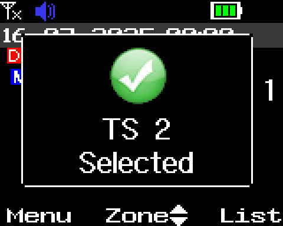

When it closes, the badge reads T2:

There is no setting: this mod is always on.

## 4. Zone scan

In stock V1.05, scan always walks the selected channel's scan list, which may hold channels from other zones and not
the zone you are in. With zone scan, the scan key (or Menu > Scan) on a memory channel scans **every channel of the
current zone**, in zone order, starting after the current channel. It works on channels that have no scan list.

- **Stopping:** if the scan is paused on a channel with activity, or still holding there after the activity ended, the
  radio stays on that channel. Otherwise it goes back to the channel where the scan started.
- Menu during a scan keeps its stock meaning: go to the last channel that had activity. PTT keeps the stock talkback.
- With TG next or previous assigned, a stop that stays on a digital channel after a group call also picks the talk
  group heard there (see section 2).
- Priority channels and the channel's auto-scan setting are ignored in zone mode. They are left as they are in the
  codeplug.
- Zones of more than 100 channels are scanned 100 at a time.
- VFO scan is unchanged.

While a zone scan runs, the channel screen steps from channel to channel of the zone:

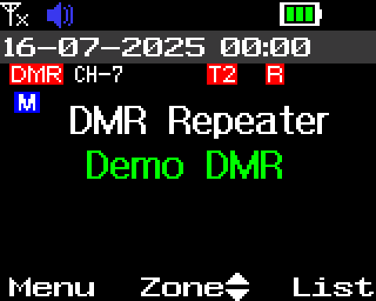

**Heard-call popup** (new in 1.2.0; TG next or previous assigned, Scan = Zone). When the scan holds on a digital
channel because of a call, a box pops up over the receive screen: the channel name and frequencies at the top, the
talk group in large letters (its name from the channel's contact or RX list or your talk-group list, else
`TG <number>`), the call type, number and slot, and the caller's number. Its keys:

| Key | What it does |
|---|---|
| Menu (**Switch**) | Stop the scan on this channel and take that talk group, so PTT answers it. For a private or all call the scan stops on the channel and the talk group stays as it was |
| Back (**Close**) | Close the box and let the scan carry on after the call. A second Back stops the scan as before |
| `*` (**Skip channel**) | Skip this channel until the next scan (the radio's own nuisance delete) |
| Any other key | Closes the box and then does its usual job |

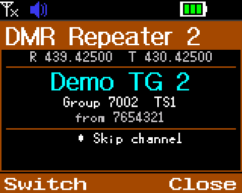

The box goes away by itself when the call is over and the scan moves on. A radio notice (low battery and so on) takes
its place, and it doesn't come back for that call. Turn it off with the **Scan popup** row in Main Menu > Scan; with it
off, the scan behaves as in 1.1.0.

**Scan settings in the Scan menu.** Main Menu > Scan has three rows after the stock ones:

| Row | Values | What it does |
|---|---|---|
| Scan | Zone / List | Zone scan (the default), or the stock scan-list scan |
| Scan popup | On / Off | The heard-call popup above. Off: no popup |
| Zone scan resume | 0.5 s / 1 s / 2 s / 5 s / 10 s | How long a zone scan waits on a channel after the activity ends before it carries on. Default 5 s. After your own transmission on the channel it waits the same time, and after a DMR call it waits for the longer of this and the radio's own call hold. List mode uses the scan list's own timing and ignores this row |

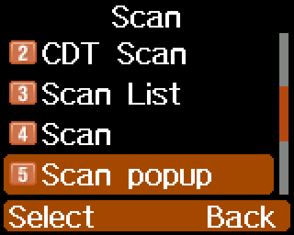

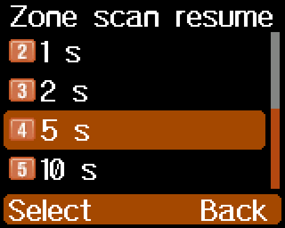

Each row asks for a value, saves it and shows a tick. Back returns to the Scan menu. **Scan** and **Scan popup** were in
the quick filters menu in 1.2.0-rc.4 and earlier; they are only here now, and keep the value you had. Like the other
Main Menu rows, the Scan menu is hidden when the codeplug forbids the VFO (stock behaviour).
- Not yet checked on a radio: the resume times on a real FM signal, and the wait after a DMR call.

The scanning itself (dwell, pausing on activity, nuisance delete) is the stock scan engine.

## 5. Quick filters menu

A small list of receive and scan settings over the channel screen. Press the key you assigned to **Priority Zone**
(the radio calls it "Quick Filters").

- **Up / Down** move between rows. Five rows show at a time; moving past the last one scrolls the list. The **knob or P2** picks the next value, **P1** the previous one. A change takes
  effect at once.
- **Menu**, **Back**, the same key again, or 10 seconds without a key close it. Changes are saved when it closes and
  survive switching off.
- PTT works as normal while it is open.

| Row | Values | What it does |
|---|---|---|
| RX match | TG / RGL / Any | Which group calls you hear. **TG**: only the talk group you would transmit to (your pick, or the channel's contact). **RGL**: the channel's RX group list, as stock with digital monitor off. **Any**: every talk group, as stock digital monitor on |
| TS filter | On / Off | On: listen on the channel's timeslot only. Off: listen on both timeslots |
| CC match | Yes / No | No: relaxes the colour-code checks the radio's main processor makes (monitor mode and the repeater colour-code limit). The DMR chip still checks the colour code on normal receive |
| TG slot | Auto / Channel | Auto: the RX list's slot for the picked member, else a `TS1` / `TS2` name suffix, sets its timeslot. Channel: always the channel's timeslot |
| Tone match | On / Off | Analogue channels with a receive CTCSS / DCS tone. **On**: as stock, the squelch opens only on the channel's tone. **Off**: it opens on any signal, whatever its tone. The channel keeps its tone, and the radio still transmits it. A busy lock set to "repeater" still uses the tone. Both sides follow the row |
| To VFO | Copy | An action, not a setting. On a memory channel, **knob or P2** copies the main side's channel (as you use it now: frequency, tones, colour code, power and so on, and on a digital channel the talk group you picked and its slot) into that side's VFO, switches to the VFO and closes the menu. The memory channel is not changed; V/M goes back to it. Shows `--` and does nothing when the side is already on the VFO, the codeplug turns the VFO off, the side is on the air band or FM radio, or while transmitting. A picked talk group that is only an ID (heard, not in your talk-group list) is not copied: the VFO keeps the channel's own contact. Each copy writes the VFO memory once |

The menu, scrolled to its last rows:

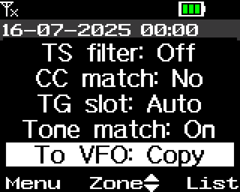

RX match and TS filter together replace the stock "Digital monitor" setting. Changing them changes that setting, and
the stock menu and the CPS see the change.

Limits:

- The clock and status icons do not update while the menu is open. Closing it redraws the screen.
- It does not open during a scan, off the channel screen, or over a popup.
- While it is open it takes every key, so TG next / previous do nothing.
- If you assign it to a long press, a second long press does not close it. Use Back, Menu or wait 10 seconds.
- Labels are in English.

## 6. Release name

Every release is a mod of the stock AnyTone firmware **V1.05**. The radio shows both:

- **Power-on screen**: your power-on message or picture as before, and the release name along the bottom, for example
  `mm9pdy-1.1.0` for a release or `mm9pdy-1.1.0-rc.1` for a release candidate. A name too long for the normal font
  is drawn in a smaller one, so it is never cut short.
- **Menu > Settings > Device Info**: "Firmware Ver:" still shows the stock **Ver 1.05**, the firmware the release is
  built on. Right after it is an extra item, **Mod Ver:**, with the release name, for example `mm9pdy-1.1.0`. The
  items after it are the stock ones, one place further down.

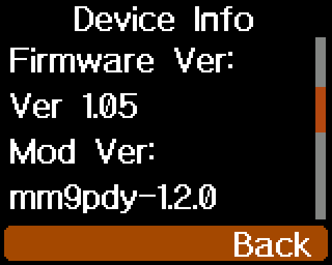

The name is `mm9pdy-` and the release number, with no `v`. The release number is the same as the published release
(`1.1.0`, `1.1.0-rc.1`). This is how you tell which release is on the radio, and that it is mm9pdy's firmware and not
stock or someone else's mod. See [install.md](install.md#4-check-it-worked).

## 7. Settings the mods keep

The quick filters menu's own settings (TS filter, CC match, TG slot, Tone match and RX match TG), the Scan menu's (Scan, Scan popup and Zone scan resume) and the
S-meter's settings (section 10: Display, Average, Peak hold and the spectrum's span, step, top and bottom) are kept in a small unused
area of the radio's settings memory, not in the codeplug format. The CPS does not show them and does not write that
area. Settings the stock radio already has (digital monitor, monitor colour code) stay in their stock place.
A CPS write or a settings reset may put the mods' settings back to their defaults (section 8).

## 8. Codeplug compatibility

The codeplug format is not changed, so the same codeplug works on stock and on a release. In short:

- The CPS shows the stock names for the three reused key functions (section 1). On stock firmware they do the stock
  thing again.
- The quick filters settings (section 7) are not in the codeplug. A write with the official CPS keeps them (checked on
  the radio); a settings reset returns them to their defaults.

The details are in [codeplug.md](codeplug.md).

## 9. Bluetooth headset: volume and microphone

With a Bluetooth headset connected, the volume knob also sets the headset's loudness, in 15 steps. Fully down still
mutes, as on stock. When the headset connects, it starts at the knob's loudness, so the Bluetooth speaker-gain value
from the CPS or the Bluetooth menu is replaced while the knob is up. Changing that menu item still works, until you next
turn the knob. Some headsets keep their own volume and may not follow the knob.

**Turning it off.** Main Menu > BT has two rows after the stock ones, **BT Knob Vol** (On or Off; On is the default) and
**BT Int Mic** (described below).

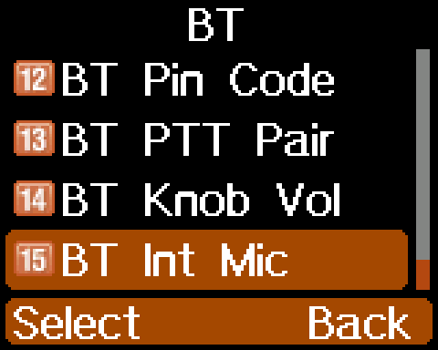

With **Off** the radio behaves as stock: the knob sets the speaker only, and the headset keeps the Bluetooth speaker-gain
value from the CPS or the Bluetooth menu, including when it reconnects. Fully down still mutes. Use it for headsets that
keep their own volume, or to set the headset once and use the knob for the speaker. With a headset connected, changing
the row takes effect at once. The setting is kept when the radio is switched off. The row appears with the other
Bluetooth rows, so it is not there when the radio has no Bluetooth module or is in Repeater Mode.

Not yet tried on a radio: whether the headset follows the knob at once, and whether the switch takes effect at once,
depends on the Bluetooth module.

**Using the radio's own microphone.** Normally, with a headset connected, everything you transmit comes from the headset's
microphone. **BT Int Mic** (Main Menu > BT, the last row; Off or On; Off is the default) changes that for the radio's own
PTT:

- **On:** when you press the radio's own PTT, the radio transmits from its own microphone, not the headset's.
- The headset's own PTT button still transmits from the headset's microphone, and so does VOX, as on stock.
- The first PTT you press decides for the whole transmission. Start with the radio's PTT and the headset's button joining
  or leaving later changes nothing; start with the headset's button and it stays on the headset's microphone.
- The emergency alarm's voice uses the headset's microphone, as on stock.
- **Off:** as stock. Everything uses the headset's microphone.

What you hear in the headset is not changed. It does nothing without a headset connected, and not in the Bluetooth KISS TNC
mode. The setting is kept when the radio is switched off. The row appears with the other Bluetooth rows, so it is not
there when the radio has no Bluetooth module or is in Repeater Mode.

Not yet tried on a radio: whether the headset's microphone is fully out of the transmission (nothing mixed in) with the
radio's PTT depends on the Bluetooth module. Also not yet tried: the sub PTT and the PTT on a hand microphone (they should
act like the main PTT), and the "first PTT decides" rule with both PTTs in use.

## 10. S-meter

The radio's signal-strength icon is four coarse steps. The S-meter adds a real reading: a **bar on the channel screen**,
a **dedicated signal screen** for comparing antennas, a **spectrum** of the band around your channel, and a **signal
history** that plots the level over the last 16 seconds. It works on
VHF and UHF, on the main (active) side. It is off until you turn it on.

> **Not yet checked on a radio.** The screens below are from an emulator, with a demo codeplug. The radio's own
> reading is real, but the **dBm and S-unit numbers are approximate** (see "Reading the numbers"). Release notes say what
> has been checked.

### Turning it on, and the menu

Everything is under **Menu > S-Meter**, the last row of the Main Menu.

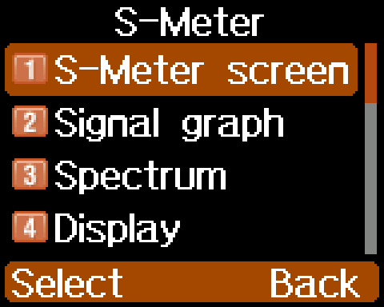

| Row | Values | What it does |
|---|---|---|
| S-Meter screen | action | Opens the dedicated screen |
| Signal graph | action | Opens the signal history |
| Spectrum | action | Opens the spectrum |
| Display | Off / Bar / Bar + raw / Bar + dBm / Bar + S | The bar on the channel screen. **Off** (the default) draws nothing. The others add a reading beside the bar: the radio's raw number, dBm or S-units |
| Average | Off / Fast / Slow | Smooths the reading. Slow is steadier, Fast follows quick changes |
| Peak hold | Off / 1 s / 3 s | Keeps a small marker at the strongest recent level, then lets it fall |
| Spectrum set | Span, Step, Top, Bottom | The spectrum's settings (below) |

Pick a value with **Menu**, the way you do in the radio's other menus. Changes are saved at once and survive switching
off. Choose **Bar + raw** first: it shows the number the radio actually measures.

### The bar on the channel screen

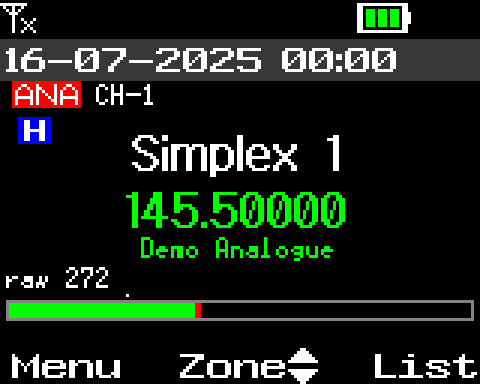

With Display set to anything but Off, a bar sits under the channel, with the reading at its left. It follows the signal
you are receiving on the main side, about ten times a second, and the marker shows the recent peak if Peak hold is on.

- **The last-call lines are not shown while the bar is on.** They use the same place on the screen. Set Display to Off
  to get them back.
- The bar shows on the single display only (see "What it does not do").
- On the air band the bar is not drawn (the radio has no signal strength there) and the last-call lines show as usual
  if they are on.
- It is hidden while a menu, the quick filters or a popup is on screen, and comes back when they close.
- A steady signal does not redraw the screen, so it does not flicker.
- **The bar is coloured by the signal's strength**, the same colours on every screen (see "Colours" below).

### Colours

The bar and the spectrum use one colour scale for the absolute level, so a colour always means the same strength:

| Level (dBm) | Colour |
|---|---|
| -120 or less | dark blue |
| about -110 | blue |
| about -100 | cyan |
| about -90 | green |
| about -80 | yellow |
| about -70 | orange |
| -60 or more | red |

On the bar the whole fill takes the colour of the current reading, and the peak marker is always red. On the spectrum every column has the colour of its own level, so changing the range (Top and Bottom) or the span changes the heights but never the colours. The levels are the approximate dBm of "Reading the numbers", so the colours are approximate until the scale is calibrated.

### The dedicated screen

Open it from **Menu > S-Meter > S-Meter screen**, or press a key you assigned to **Satellite Predicting** in the CPS
(shown in the radio as "S-Meter", section 1).

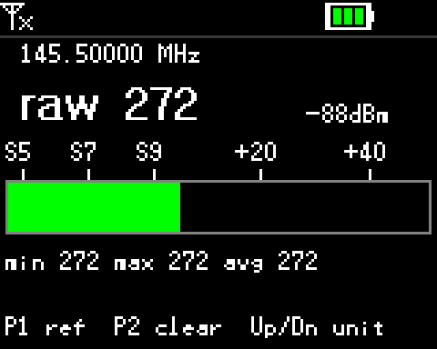

It shows the receive frequency, a large reading, a scale with S5 to +40, a big bar, and the lowest, highest and average
reading since the last restart. The keys are on its bottom line:

| Key | Does |
|---|---|
| **Up / Down** | Changes the unit of the large reading: raw, dBm, S-units |
| **P1** | Sets the reference for delta mode (below) |
| **P2** | Restarts the lowest, highest and average, and clears the delta reference |
| **Menu, Back**, or the key you assigned | Close it |

Every other key does nothing while it is open, so the channel knob cannot change the channel under it. It does not time
out: it is for watching. It closes by itself when a call is received or when you transmit.

**Delta mode, for comparing antennas.** Receive a steady signal on antenna A and press **P1**: the reading is stored as
the reference and the large number turns into the **difference from it**, starting at `+0.0dB`. Change antenna (or
position, or feeder) and the number shows how many dB better or worse it is. A line under the statistics shows the
reference and the difference.

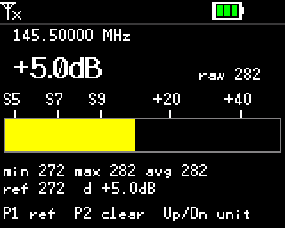

**P2** clears the reference (and the statistics). A long press of **P1** also clears the reference. Delta mode is the
most trustworthy use of the meter, because it compares two readings of the same receiver and does not depend on the dBm
scale being exact.

### The spectrum

Open it from **Menu > S-Meter > Spectrum**. The radio tunes its receiver across a stretch of the band around your
channel, one point at a time, and draws the signal level at each point as a bar. A taller bar is a stronger signal, and
the marker (a yellow strip under the graph, with its frequency and level below it) shows one point. Each bar is coloured by its signal level (see "Colours"). The sweep goes round left to right and redraws each bar as it passes; a short blank gap moves ahead of it, so you can see where it has got to.

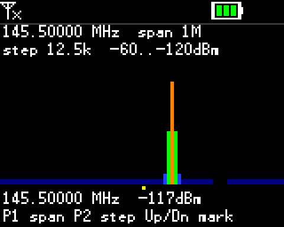

| Key | Does |
|---|---|
| **Up / Down** | Moves the marker one point |
| **P1** | Next span |
| **P2** | Next step |
| **Menu, Back** | Close |

**Menu > S-Meter > Spectrum set** holds the same settings: **Span** (100 kHz to 5 MHz around the channel), **Step**
(12.5, 6.25 or 25 kHz between points), and **Top** and **Bottom**, the dBm values at the top and bottom of the graph.
A change takes effect at the next sweep and is saved when the screen closes.

While it sweeps, the receiver is tuned away from your channel and the screen keeps the backlight on, so **you will not
hear your channel**. It closes by itself, and the radio returns to your channel, when you transmit, when a call is
received, or when a scan starts. If it cannot start (air band, a scan running, a transmission, a call), the top line
reads "no sweep" with a number and nothing is drawn. The sweep stays inside the band the channel is in.

### The signal history

Open it from **Menu > S-Meter > Signal graph**. It watches your channel and plots the signal level over time, like a heart
monitor: each 0.1 second adds one column, and the writing point moves from left to right across the screen, 16 seconds
from edge to edge. At the right edge it wraps to the left and writes over the oldest columns. A short blank gap just
ahead of the writing point shows where "now" is. Nothing scrolls, so the picture stays easy to read.

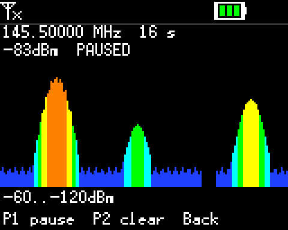

A taller column is a stronger signal, and each column is coloured by its level (see "Colours"). The top and bottom of
the graph are the **Top** and **Bottom** of the spectrum's settings, so the two screens agree. The header shows the
channel frequency, the time across the screen and the current reading in dBm. The radio does not retune: you keep
hearing your channel, and the history uses the same smoothing (Average) as the bar.

| Key | Does |
|---|---|
| **P1** | Pause the trace; press again to continue. The header shows PAUSED |
| **P2** | Clear the trace and start again at the left |
| **Menu, Back** | Close |

The screen keeps the backlight on while it is open. It closes by itself when you transmit or a call is received, and the
trace starts empty each time you open it. It does not measure on the air band.

### Reading the numbers

- **Raw** is the radio's own signal-strength reading, a number that grows with the signal. It is the one value that is
  exact, and it changes by band: the radio has a different calibration point for VHF and UHF, which the screens take
  into account for the bar.
- **dBm and S-units are approximate until calibrated.** They come from a fixed scale (S9 is -93 dBm, six dB per
  S-unit), not from a measurement of your radio against a signal generator. Expect them to be off by several dB, and
  by different amounts on different bands. Use them to get an idea, and use delta mode to compare.

### What it does not do

- **The dual display is not supported.** With both channels on screen the bar is not drawn. The dedicated screen and
  the spectrum are meant for use with one channel on screen.
- **No meter on the air band (108 to 136 MHz).** The radio listens to the air band with a separate receiver that does
  not report signal strength. The bar on the channel screen is not drawn there, and the channel screen is as it is with
  the meter off. The full-screen meter reads "Air band" and "Cannot measure", the spectrum will not start, and the signal
  history draws nothing. The bar comes back when the main side is on any other channel. Not yet checked on a radio.
- It does not measure while you transmit, and it does not change anything about receiving, squelch or scanning.
- Labels are in English.

## 11. Volume range and volume bar

The volume knob can be given a **range**: a different mapping from the knob's position to loudness, and a true mute at
the bottom of the knob. A **volume bar** on the screen shows the knob's level, and its Menu key changes the range.
Out of the box nothing changes: the range is **Stock**, which behaves exactly as stock V1.05.

**The ranges**

| Range | What the knob does |
|---|---|
| Stock | The stock mapping, including the stock "Max Vol Level" setting. This is the default. |
| Indoor | Quiet and fine-grained: the top of the knob stays well below full loudness. For a desk or a quiet room. |
| Outdoor | Loud: the knob starts fairly high and the top is full loudness. For a noisy place. |
| Full | The widest spread: a very quiet bottom and full loudness at the top. |

The knob is always in charge. A range only changes how a knob position maps to loudness; nothing on screen holds a
volume of its own. With Indoor, Outdoor or Full, the stock "Max Vol Level" setting is ignored (it still applies in
Stock).

**Mute.** With a range on, the bottom of the knob is a true mute, and it does not flutter between silent and
quiet when the knob rests close to the edge. The top of the knob holds full level the same way.

**The volume bar.** Turning the knob shows the stock volume bar, with a line under it naming the range:

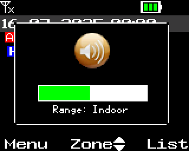

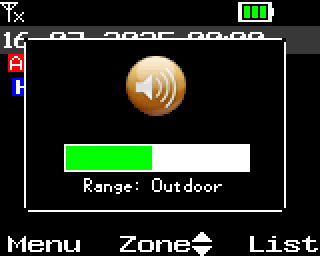

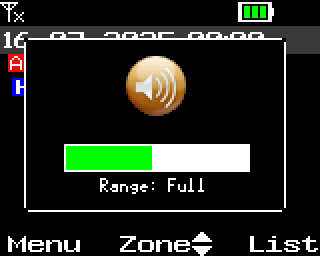

With the range on Stock, the line reads `Range: Stock` and the loudness is the release's:

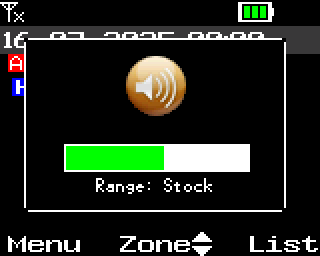

The bar goes away by itself after a few seconds, and each knob step restarts the wait. It does not appear over the
heard-call card, the quick filters or the menus; the knob still changes the volume there.

**Turning the bar on.** The bar is stock's own option. Turn it on in **Settings > Radio Set > Voice Func >
Vol Popup** (section 12), or in the CPS (the option for the volume bar, shown as "Volume Change Prompt" in some CPS
versions) and write the codeplug. With it off there is no bar, so the range cannot be changed from the bar (the Vol Range row below works either way).

**Changing the range.** While the bar is showing, press **Menu**: the range goes Stock, Indoor, Outdoor, Full, and then
round to Stock again, and the loudness follows at once. The bar stays up and the line changes. Any other key closes the bar, as on stock. The choice is remembered across power-off,
and is saved a moment after the bar has closed; switching the radio off while the bar is still up loses the change.

**Earpiece and Bluetooth.** An earpiece keeps its own stock level setting under every range. With a Bluetooth headset
connected, the range does not apply and Menu does nothing on the bar: the bar still shows the knob's level, with the line
`Range: BT`. The headset behaves as in section 9.

**Limits**

- The loudness levels of each range are provisional and may be retuned in a later release.
- Beeps, tones and voice prompts follow the knob and the range like received audio.
- The bar's behaviour during transmit and its look on the real screen are unchecked; stock's rules apply there.
- The "Key Max Volume" function and the stock Max Vol Level menu row still change the stock setting and still show
  their pop-up, but you hear nothing from them under Indoor, Outdoor or Full.

Not yet checked on a radio: all of this section has been run in an emulator only, including the mute edges, the three
ranges and the bar. Whether the knob's bottom position gives a clean mute and where each range sounds right on the real
volume control is still to be tried.

## 12. Vol Popup and Vol Range menu rows

**Settings > Radio Set > Voice Func** has two more rows at the end of its list, **Vol Popup** (Off / On) and **Vol Range** (Stock / Indoor / Outdoor / Full).

**Vol Popup** turns the
stock volume bar of section 11 on and off: with **On**, turning the volume knob shows the volume bar on the screen for a few seconds.
It is the same setting as the CPS option for the volume bar (shown as "Volume Change Prompt" in some CPS versions), which until now was the only way to change it, so a
value set on the radio is what the CPS reads back, and the other way round. Choose a value and press Select: the radio
saves it and returns to the list.

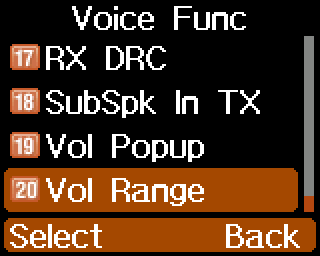

**Vol Range** chooses the volume range of section 11 without the bar: Stock, Indoor, Outdoor or Full. The list opens on
the range in use. Choose a value and press Select: the loudness changes at once, with the knob where it is, and the radio
saves the choice and returns to the list. It is the same setting the Menu key cycles on the volume bar, so either one
shows what the other set. Stock is the default and leaves the radio's volume exactly as it was.

Limits: Vol Popup only switches the bar and does not change how the knob maps to loudness. Vol Range does not need the bar
to be on. An earpiece or a Bluetooth headset behaves as described in section 11.

Not yet checked on a radio: that the bar then appears on a knob turn on the real radio, that the CPS reads the saved
value back, and how each range sounds. All of it has been run in an emulator only.

## 13. Channel distance

From 1.2.0-rc.2. On the channel screen, a memory channel that has a stored position shows how far away its site is and
in which direction, from the radio's own GPS fix: `850m N`, `4.3km NE`, `27km SW`. It sits at the right of the small
zone line under line 2:

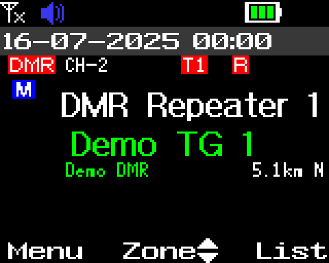

**How a channel gets a position.** The positions are written by Codeplug Studio's MM9PDY target, together with the
codeplug: one position per memory channel. There is nothing to set on the radio, and the official CPS cannot write
them. After an official CPS write the positions are still there, but a channel the CPS moved or renamed shows no
distance until Studio writes the positions again.

**When it shows.** Only when all of these hold; otherwise the place is empty:

- the radio's **GPS is on** and has a **fix**, with a GPS sentence in the last three minutes;
- the screen is the channel screen on a **memory channel** that has a position, with one channel on screen (see below);
- you are not scanning, and not in VFO mode;
- the channel is the one Studio wrote: a channel you retune or rename on the radio shows nothing until Studio writes the
  positions again;
- the site is under 1000 km away.

**What it shows.** The distance, then one of eight compass points (N, NE, E, SE, S, SW, W, NW) for the direction from
you to the site, relative to true north. It is in metres below 1 km (`850m`), in kilometres or miles above, with one
decimal below 10 (`4.3km`) and whole numbers after that (`27km`). The unit is the one Studio wrote with the
positions; the radio has no setting for it. The number changes at most every few seconds, so it does not flicker.

**Limits**

- **Single display only.** With both sides on screen (CPS "sub channel" on) no distance is shown, on either side.
- The zone name moves to the left while a distance shows, so both fit.
- A GPS fix indoors may never come: the distance appears once the radio has one.

Not yet checked on a radio: the distance against a site whose position you know, the longest texts (`999km NW`,
`9.9mi NW`) showing whole, and the positions after an official CPS write. A Codeplug Studio write and the distance
showing have been checked on a radio.
