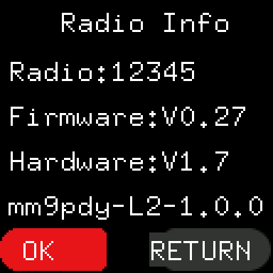

# Baofeng UV-5R Mini (MM9PDY)

> **Release candidate docs: 1.0.0-rc.1** These pages describe a release candidate that is still being tested.

A small, free modification of the Baofeng UV-5R Mini's own firmware. It adds zones (named groups of channels for
each side of the radio), shows each side's zone on the idle screen, scans inside a zone, and names the build in Radio
Info. Everything else works as the maker made it. It is written to the radio with
[Codeplug Studio](https://codeplug.mm9pdy.net) and the radio's programming cable.

This is for the **UV-5R Mini** only, not the UV-5RM or UV-5RH, which are different radios inside.

## What it does

| Feature | What you get | Page |
|---|---|---|
| Zones | Each side of the radio works with a named group of channels; Up and Down step only through it | [zones.md](zones.md#choosing-a-zone) |
| Zone line | The idle screen shows each side's zone under the channel name | [zones.md](zones.md#seeing-each-sides-zone) |
| Zone scan | A scan in a zone visits only that zone's channels, with or without SCAN ADD | [zones.md](zones.md#scanning-a-zone) |
| Build name | The power-on screen and Radio Info show which MM9PDY build the radio runs | [install.md](install.md#3-check-it-worked) |

## Pages

| Page | What it is for |
|---|---|
| [install.md](install.md) | Putting it on the radio with Codeplug Studio |
| [zones.md](zones.md) | Zones: setting them up, choosing one, the zone line, scanning |
| [back-to-stock.md](back-to-stock.md) | Putting the maker's firmware back |
| [recovery.md](recovery.md) | If an update stops half way, or the radio does not start |

## Read this first

- **It is a risk.** Writing firmware can leave a radio that does not start. There is a way back for most failures
  ([recovery.md](recovery.md)), but a few need the radio repaired with the case open. You accept the risk, and it is
  your radio. Nothing here is a promise.
- **One kind of UV-5R Mini only.** Release 1.0.0 is for radios that came with this exact combination:

  | What | Must read | Where to see it |
  |---|---|---|
  | Firmware | `V0.27` | **MENU**, then **UP** to the last item, **Radio Info**, then **MENU**: the line `Firmware:V0.27` |
  | Hardware | `V1.7` | The same screen: the line `Hardware:V1.7` |
  | Suffix | `NRF` | A hidden screen: switch the radio off, hold **8** while you switch it on, and for about a second it shows `5RMINI NRF` (or `5RMINI NRFB`) |

  The suffix screen goes by quickly. Switch off and do it again if you miss it, or film it with a phone. Release your
  finger from **8** whenever you like; the radio carries on starting normally.

  Any other combination (for example `5RMINI NRFB`, or Firmware `V0.04`) is not supported by 1.0.0. Codeplug Studio
  stops and writes nothing. Do not try to work round it.
- **Studio can't read these over the cable.** The radio does not send them, so on a first install Studio asks you for
  all three. Read them off the radio before you start; never guess.
- **Writing firmware does not touch your channels.** Channels, settings and calibration stay as they are. Take a
  backup with Codeplug Studio before you start anyway.
- **Keep a way back.** Keep the stock firmware file (see [install.md](install.md#what-you-need)) and the release's to-stock file
  ([back-to-stock.md](back-to-stock.md)).
- **Release candidates** (versions ending `-rc.1`, `-rc.2`, ...) are for testing and may have faults.

After the MM9PDY firmware is installed, Radio Info gains a fourth line with the build name, for example
`mm9pdy-L2-1.0.0`. The Firmware and Hardware lines and the hold-**8** screen stay the same as before.

