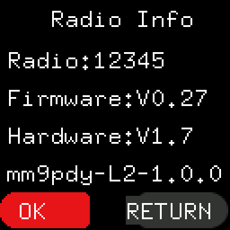

# Installing

> **Release candidate docs: 1.0.0-rc.1** These pages describe a release candidate that is still being tested.

Steps marked *Not yet checked on a radio* are a plan, not a record. Steps marked *Checked on a radio once, with test
builds* were done once, with test builds that differ from a release only in the build name. Do not rely on any of it
more than that.

## What you need

- A UV-5R Mini with the combination on [the first page](README.md#read-this-first): suffix `NRF`, Firmware `V0.27`,
  Hardware `V1.7`. Note all three down before you start.
- A fully charged battery. The update takes about 3 minutes, and the battery must not run out or be moved during it.
- The radio's programming cable.
- A computer with Chrome or Edge, which can talk to the cable from a web page.
- The stock firmware file for your radio, `stock-nrf-v0.27.ufw`.
  Baofeng does not publish the Mini's stock firmware, and this project does not host it. Codeplug Studio's stock
  file step links to an unofficial copy shared by a third party. Whichever copy you use, Studio checks it against the
  exact file it expects and refuses anything else.
- Time to do it without being interrupted.

## 1. Before you start

1. **Not yet checked on a radio.** Make a backup of the codeplug with Codeplug Studio (Read, then save).
2. **Not yet checked on a radio.** Keep the stock firmware file somewhere you can find it again: you need it to go
   back to stock or to repair an update ([back-to-stock.md](back-to-stock.md), [recovery.md](recovery.md)).

## 2. Write it with Codeplug Studio

1. **Checked on a radio once, with test builds.** Open [Codeplug Studio](https://codeplug.mm9pdy.net), go to the
   *Firmware flasher*, and pick the UV-5R Mini.
2. **Not yet checked on a radio.** Choose the release. Studio offers final releases; release candidates are shown
   only when you ask for them.
3. **Checked on a radio once, with test builds.** Drop in your stock firmware file. Studio checks it and refuses a
   file it does not know.
4. **Not yet checked on a radio.** With the radio switched on as normal and the cable in, let Studio read the radio.
   - A radio already running an MM9PDY build tells Studio which build it has, and Studio asks nothing.
   - A stock radio can't tell Studio its version, so Studio asks what Radio Info shows: pick the **Firmware** and
     **Hardware** lines from the lists, and confirm the suffix. Studio stops if they are not `V0.27`, `V1.7` and
     `NRF`.
5. **Checked on a radio once, with test builds.** Put the radio into update mode: switch it off, hold **PTT-A** and
   **=** together, and switch it on. Let go when the screen shows a computer picture and `UPDATE...`.
   If the red TX light comes on, or the normal screen appears, switch the radio off at once and try again.
6. **Checked on a radio once, with test builds.** Press **Connect and flash** in Studio and choose the cable's port.
   The radio drives the update from here: it takes about 3 minutes. Do not touch the radio, the cable or the battery
   until Studio says it has finished and the radio shows its normal screen.

If the update is cut part way (the cable comes out, the battery runs down), see [recovery.md](recovery.md): you can
carry on with the same files.

If Studio was given the file for another kind of UV-5R Mini, the radio refuses it before anything is installed. Its FM
radio presets and volume may be reset; nothing else changes. A file that does not match this radio's own key is
refused before anything is written ("not for this radio's key").

## 3. Check it worked

1. **Checked on a radio once, with test builds.** The radio restarts by itself and shows its normal screen.
2. **Checked on a radio once, with test builds.** Switch the radio off and on again. The power-on screen shows the
   build name, for example `mm9pdy-L2-1.0.0`.
3. **Checked on a radio once, with test builds.** Press **MENU**, then **UP** to **Radio Info**, then **MENU**. The
   fourth line shows the same build name. The Firmware and Hardware lines are unchanged.
4. **Not yet checked on a radio.** Your channels and settings are as they were. Zones are written separately, as part
   of the codeplug ([zones.md](zones.md#setting-up-zones)).

If anything is different or the radio does not start, go to [recovery.md](recovery.md).

## Writing the same build again

Writing the build the radio already has is a repair, for example after something went wrong. **Not yet checked on a
radio.** Studio sees that the radio already runs this build and asks you to tick *Write it again anyway* before it
goes on. The steps are then the same as above.
