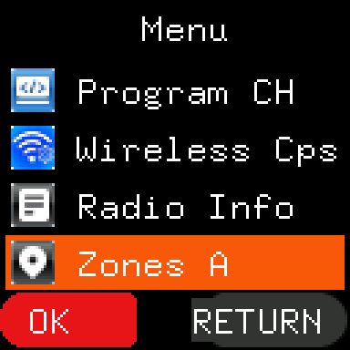
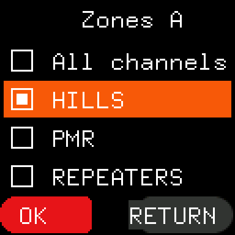
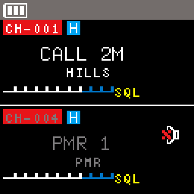
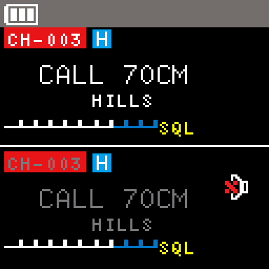
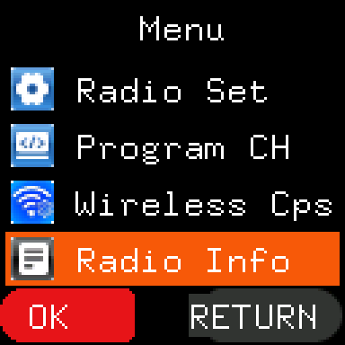

# Zones

> **Release candidate docs: 1.0.0-rc.1** These pages describe a release candidate that is still being tested.

Zones let each side of the radio work with a named group of channels instead of all of them. With side A in a zone
called "HOME", Up and Down on side A visit only HOME's channels, while side B can use another zone or all channels.

Zones need the MM9PDY firmware for the UV-5R Mini, release 1.0.0, which is for radios that came with suffix `NRF`,
Firmware `V0.27` and Hardware `V1.7` (see [the first page](README.md#read-this-first)).

## Setting up zones

Zones are written by **Codeplug Studio**, as part of the codeplug, when the radio is the MM9PDY Mini target:

- up to 24 zones;
- each with a name of 1 to 12 characters (letters, digits, spaces and punctuation);
- each holding any of the 999 channel numbers, and a channel may be in more than one zone.

The radio restarts after the write and reads the zones as it starts.

## Choosing a zone

1. On the idle screen, make the side you want active (A/B) and put it in channel mode (V/M).
2. Press **MENU**, then **UP** once: the cursor wraps to the last item, **Zones A** (or **Zones B** when side B is
   active), shown with a location-pin icon.

   

3. Press **MENU**. The list shows **All channels**, then every zone that has at least one channel in it. The side's
   current zone is highlighted, and the cursor starts on it.

   

4. Move with **UP** and **DOWN** and press **MENU** to choose. The radio goes back to the idle screen with the side
   in that zone. **EXIT** leaves the list without changing anything.

When you choose a zone, the side stays on its channel if that channel is in the zone. Otherwise it goes back to the
channel it last used in that zone since the radio was switched on, or to the zone's first channel. Choosing **All
channels** keeps the channel. There is no voice prompt.

The radio remembers each side's zone when it is switched off.

The Zones item is not shown while the active side is in VFO (frequency) mode, or when the radio has no zones. The
menu is then the same as the standard firmware's. In the Chinese menu the item and the zone names are shown in the
same Latin letters.

## Seeing each side's zone

When the display mode (Program CH › CH-MDF) is **NAME**, the idle screen shows each side's zone in small letters
just under the channel name: the zone's name, or **All channels** when the side is not in a zone. Like the channel
name, it is white on the active side and grey on the other. It changes as soon as the zone does: after choosing a
zone, after Up or Down, and after A/B.

The zone is not shown:

- in **FREQ** or **CH** display mode, where the large digits fill that part of the screen;
- on a channel without a name, which shows its frequency instead (as the standard firmware does);
- while the side is in VFO (frequency) mode;
- when the radio has no zones.

The screen is then the same as the standard firmware's.

## Using a zone

- **Up and Down** (and holding them) step only through the zone's channels, in channel-number order, wrapping round
  at either end.
- **Typing a channel number** still reaches any channel, in the zone or not. The next Up or Down goes to the zone's
  next channel above or below it.
- **Deleting channels** (Program CH › CH-Delete): if you delete the side's channel, it moves to the zone's next
  channel. If a zone loses its last channel, the side goes to All channels, and the zone is no longer listed until a
  channel is put back in it.

## Scanning a zone

When the active side is in a zone, a scan (started as usual, with the key set to scan) goes only through that
zone's channels:

- the zone's channels that have **SCAN ADD** on;
- or, when none of the zone's channels has SCAN ADD, all of the zone's channels.

So a zone can be scanned without changing any channel's SCAN ADD, and a scan in a zone starts even when no channel
on the radio has SCAN ADD. A signal stops the scan only on one of the zone's channels; channels outside the zone are
never visited. Stopping the scan keeps the channel it is on, and the radio remembers it with the zone. Up and Down
during a scan change direction, still inside the zone.

In **All channels**, scan works as in the standard firmware: every channel with SCAN ADD.

## A codeplug without zones

If the codeplug has no zones, or the radio finds the zone data damaged, the radio behaves exactly like the standard
firmware: no Zones item, Up and Down step through every channel, and scan uses SCAN ADD as usual.

## Factory reset

**Radio Set › Reset › Reset All** erases the channels and settings, but not the zones. After the next power-on the
zones are back. A zone that lists channel numbers the reset fills with its default channels holds those channels
again.
