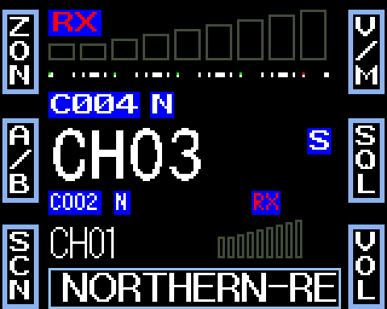
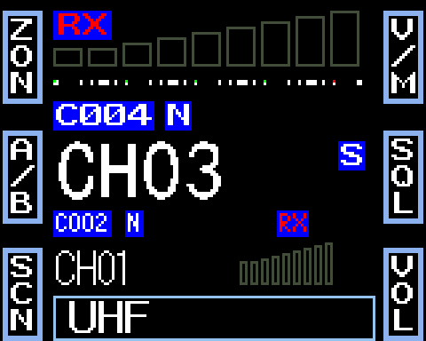
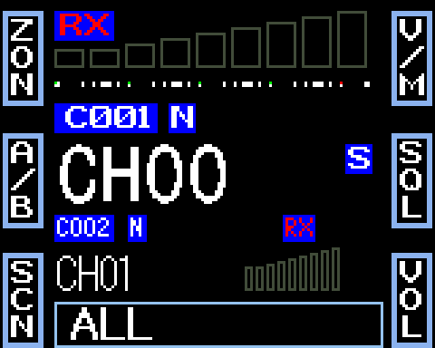
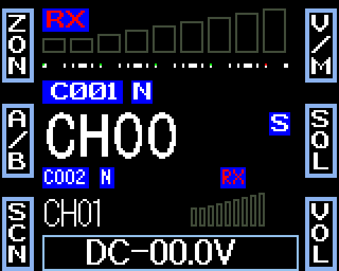
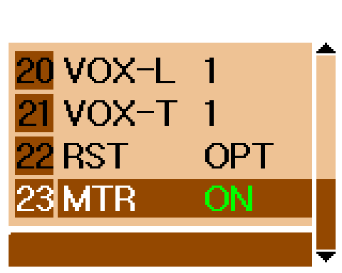
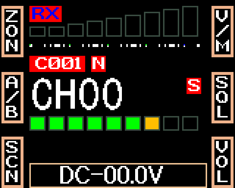
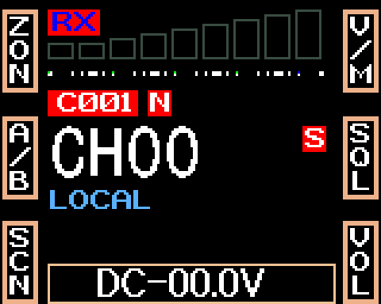
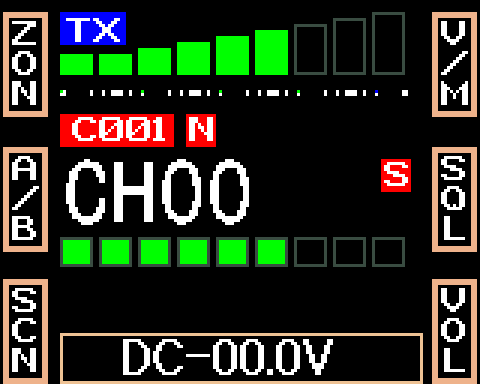

# What it does

The modification is the unmodified front-panel firmware plus the changes below: the version line, zones, channel
descriptions with a new single-watch layout, the Scan Pause Time on carrier scan, skipping a channel during a scan, and an audio level meter (with the radio board update). Everything else is as the maker made it.

Each feature adds a row to this table in the release that ships it, and the row says how far it has been checked.

| Feature | What you see | Since | Checked on a radio |
|---|---|---|---|
| [Version on the power-on screen](#version-on-the-power-on-screen) | A small line along the bottom of the power-on screen: `MM9PDY-` and the firmware version | 1.0.0-rc.2 | Yes, on test builds of 1.0.0-rc.2 and 1.1.0 |
| [Zones](#zones) | Group your channels into up to 32 named zones in Codeplug Studio, then pick one with the key set to DIR (the radio shows ZON). The knob, mic Up and Down and scan follow each zone's own order; each zone can have its own set of channels to scan | 1.1.0; per-zone scan sets, zone order and the channel you land on when you switch zone: 1.2.0 | Once, on a test build of 1.1.0; long names cut to fit once, on a test build of 1.1.3; scan sets, zone order and switching zone once, on test builds of 1.2.0 |
| [Channel descriptions](#channel-descriptions) | In single watch, a short description (up to 12 characters, the channel's Name in Studio) in amber under the channel name, with the zone name in sky blue above it. Dual watch is unchanged | 1.1.0 | Once, on a test build of 1.1.0 |
| [CO scan and Scan Pause Time](#co-scan-and-scan-pause-time) | In carrier-operated (CO) scan, after the signal goes the radio waits the Scan Pause Time already in the menu (5, 10 or 15 seconds), then continues. Time-operated and search scan are unchanged | 1.1.2 | Once, on a test build of 1.1.2: the 5 second setting |
| [Nuisance delete in scan](#nuisance-delete-in-scan) | While a scan is stopped on a channel, hold SCN to skip that channel. The skip lasts until you switch the radio off | 1.1.3 (until the next scan start); 1.2.0 (until switch-off) | Once each, on test builds of 1.1.3 and 1.2.0 |
| [Audio level meter](#audio-level-meter) | In single watch, a 9-segment level in the zone-name row, under the signal bars: the received audio while receiving, your microphone level while you transmit; needs the RF CPU update; off by default, turn it on with MTR in the FUNC MENU | 1.2.0 | Yes, on test builds of the front panel and the radio board |

The vendor's own version text (what the official programming software and Codeplug Studio read from the radio) is not
changed. The release name appears separately, as `mm9pdy-` plus the version (shown in capitals on the power-on screen).

## Version on the power-on screen

**Checked on a radio**, on test builds that differ from this release only in the text of the line.

When the radio starts, the power-on screen shows its usual text (RETEVIS, or your own) and, in small letters along the
bottom, `MM9PDY-` followed by the firmware version. The line stays as long as the power-on screen does. The radio's
small text is capitals only, so it reads in capitals.

| Firmware | The line reads |
|---|---|
| A release | `MM9PDY-1.0.0` |
| A release candidate | `MM9PDY-1.0.0-RC.2` |
| A test build | `MM9PDY-G` followed by a code, such as `MM9PDY-G1A2B3C` |

Where to look: the power-on screen only. The radio has no version page of its own, and the maker's test screen (which
you reach by holding **FUNC** and pressing **P4**) keeps showing the maker's version text; do not use it to check this
feature. Everything else on every screen is as before.

## Zones

**Checked on a radio once**, on a test build that differs from the release only in the version line.

**Long names.** The popup shows the zone name by itself, with room for eight wide letters or nine to ten ordinary capitals
(seven W, eight M). A longer name is cut to fit, so `NORTHERN-REP` shows as `NORTHERN-RE`. The name itself is not changed, and the
zone line under the channel in single watch (when it is on) shows more of it. Nothing is drawn past the box.

*A twelve-character name cut to fit. Demo channels and zones, in dual watch.*

A zone is a named group of your channels, such as `LOCAL` or `UHF`. You make zones in Codeplug Studio (its MM9PDY
target writes them with the rest of your codeplug); the radio never edits them. A zone has 1 to 12 characters in its name,
and there can be up to 32 zones.

**Setting it up.** Give a key the function **DIR**: a P-key (in the official CPS, in Codeplug Studio, or in the radio's
MINI KEY menu) or a key on the keypad microphone (PA to PD, in the radio's HAND KEY menu). The radio then labels that key
**ZON**, and the popup it opens shows the name of the zone. Codeplug Studio's MM9PDY target can set the key for you. The DIR item in the
radio's FUNC MENU is not changed: it still flips the screen.

*The popup shows the zone name; the key at the top left now reads ZON. Demo channels and zones, in dual watch.*

**Using it.**

1. Press the ZON key. The bottom line shows the name of the current zone (`ALL` for all channels).
2. Turn the knob, or press the microphone's Up and Down keys. You step through **All channels**, then each zone that has at
   least one of its channels on the radio, and round again. The radio changes to a channel of the new zone: the one you last used in that zone, else its first channel in the order you gave it in Codeplug Studio (the lowest for a zone without an order). For a moment after switching on, writing from Codeplug Studio or deleting a channel, a zone you have not used yet may start on its lowest channel instead. It does not stay on your channel just because the new zone has it too; switching to **All channels** keeps it. Each side remembers its own last channel in each zone while the radio is on. Checked on a radio once, on a test build of 1.2.0.
   
3. Press **PUSH**, any other key, or wait a few seconds to leave the popup.

**What a zone changes.**

| | |
|---|---|
| Stepping | The knob and microphone's Up and Down keys follow the zone's order from Codeplug Studio, wrapping and skipping channels that are not on the radio. Different zones can order the same channels differently. All channels uses channel-number order. From a channel outside the zone, the first step goes to the nearest zone channel by number in that direction, then follows zone order. For a moment after changing zone or switching on, a step may use channel-number order within the zone while its order loads. Older zone data without an order, or a damaged order, also uses channel-number order for that zone. A zone with a single channel answers `ERROR` to a step. Checked on a radio once, on a test build of 1.2.0 |
| Delete | Deleting a channel on the radio moves to the next channel in the zone's order. Not yet checked on a radio |
| Scan | Scans the zone's **scan set**: the zone's channels that are marked *Scan in this zone* in Codeplug Studio (all of them unless you skip some), in the zone's order, starting with the next channel in that order. *Scan in All channels*, each channel's own scan flag, plays no part inside a zone. A channel can be scanned in one zone and skipped in another. A zone with fewer than two channels in its set answers `ERROR` at the scan key. Checked on a radio once, on a test build of 1.2.0 |
| Typing a number | Typing a channel number on the microphone keypad still goes to that channel, in the zone or not. The next step returns to the nearest zone channel by number in that direction, then follows zone order (not yet checked on a radio) |
| Two sides | Side A and side B each keep their own zone. Swapping A and B, or a side change when you transmit in dual watch, keeps each side's zone |
| Switching off | The radio remembers each side's zone, and starts in it next time |
| VFO mode | The key does nothing in VFO mode |

**When something is not right.** The radio then behaves as it does without zones, with all channels:

- there are no zones, or the zone data is damaged;
- the radio's memory chip is too small for them (a radio with a 16 KiB chip keeps no zones);
- a zone's channels are all gone (the zone is not offered, and a side whose zone empties goes to All).

One damaged zone is left out; the others still work.

Scan has its own fallbacks. A zone written by an older Codeplug Studio, which has no scan sets, scans as the previous release did: its channels that are also in the All channels scan list. A zone whose scan set is damaged scans the same way; the other zones are not affected, and a zone never scans channels of another zone. Right after you change zone, or switch on, the radio takes a fraction of a second to read the zone's scan set; a scan started in that moment covers the zone's channels in the All channels scan list until the set is read. Not yet checked on a radio.

**Known limits of scan in a zone.**

- **Pressing PTT during a scan** transmits on the channel the scan is passing, as the radio always did. It does not return to the channel where the scan started first. Pressing PTT while the scan is held on a signal transmits there and stops the scan.
- **The radio's own scan add and skip** (in the menu, or the **SKP** setting) change only *Scan in All channels*. They cannot edit a zone's scan set, which comes from Codeplug Studio, so inside a zone they do not change the **S** on the channel line (it follows the zone's scan set).

**Your codeplug.** The official CPS and CHIRP do not read or write zones and do not disturb them. Zones are matched by
channel number, so if you edit your channels with them, check your zones in Codeplug Studio afterwards.

## CO scan and Scan Pause Time

**Checked on a radio once**, on a test build that differs from the release only in the version line, with the 5 second setting. The 10 and 15 second settings and VFO scan have not been timed on a radio.

In **CO** scan the radio already stayed on a channel while a signal was present. It now also waits the **Scan Pause Time (SCT)** after the signal goes before it moves on—the same **5, 10 or 15 seconds** the FUNC MENU already offers for SCT (labels 5S, 10S, 15S). If the signal comes back during that wait, the timer starts again. **TO** scan still pauses for SCT from when the carrier appears; **SE** (search) still stops when a signal is found. Nothing new appears in the menu and the codeplug is unchanged.

**Release note:** CO scan waits the Scan Pause Time after the signal drops, using the existing 5 / 10 / 15 second menu values.

## Nuisance delete in scan

**Checked on a radio once**, on a test build of 1.2.0: the skip lasts until the radio is switched off, including with the power button. (1.1.3 skipped the channel only until the next scan start.)

While a scan is stopped on a channel, the **SCN** key on the screen changes to read **NUI**. Hold **SCN** for about a second. That channel is skipped until you switch the radio off: you get the usual key beep, if beeps are on, and the scan moves on to the next channel at once. A skipped channel is not stopped on again, even after you stop the scan and start it again, change zone, or switch between memory and VFO. Switching the radio off and on brings every channel back, and so does a programming session with Studio or the CPS. Nothing in your codeplug changes, and the channel stays as it was in your scan settings.

- **The label.** The key reads **NUI** only while holding it would skip the channel. While the scan is moving it reads **SCN**, and it goes back to **SCN** a moment before the scan moves on after a signal.
- **When it works.** Only while the scan is stopped on a channel: a signal is present, or the radio is waiting after it went (the Scan Pause Time in carrier scan, the pause in time scan). If the scan is moving, holding **SCN** stops it, as before.
- **The last channel.** The radio will not skip the only channel left to scan. It shows `ERROR` and stays on that channel.
- **The `S` on the channel screen.** The small **S** by the channel line shows whether the channel is scanned: in a zone, whether it is in the zone's scan set (once the radio has read the set, a fraction of a second after you change zone); in All channels, the channel's own scan setting (Scan in All channels). While a channel is skipped for now, its box is **grey** instead of blue, so you can tell a temporary skip from a channel that is scanned. During a scan the **S** is red, as before.
- **If the skips leave a zone with nothing to scan** (a channel can be in more than one zone, so skips made in one zone can cover all of another), the radio brings that zone's channels back rather than refusing to scan; skips on channels outside it stay.
- **Two skips out of three.** If you skip all but one channel, stop and start the scan, the scan stays on the one channel left and re-tunes to it about twice a second, where the stock radio would show `ERROR`. Switch the radio off and on to bring the others back.
- **Editing a skipped channel.** Deleting it, storing the VFO into it or turning its SKP setting on or off drops its skip.
- **Zones.** In a zone, the skip is inside the zone, and it follows the channel into every zone that holds it. Mic Up and Down and the knob also pass over a skipped channel while the scan runs.
- **Search scan (SE).** A signal stops the scan, so there is almost nothing to skip. Holding **SCN** after a stop is the radio's own skip, not this feature.
- **Be careful when not scanning.** Holding **SCN** when no scan is running is the radio's own **permanent** skip of that channel (it shows `SKP`), exactly as before. Hold it only while a scan is stopped on a channel.
- **No "unskip all" yet.** To bring every skipped channel back, switch the radio off and on.
- **Not covered.** It is the front-panel **SCN** key only, not a microphone key. VFO (band) scan is unchanged.

**Release note:** While a scan is stopped on a channel, hold SCN for about a second to skip that channel until you switch the radio off. Stopping and restarting the scan keeps the skip, and a skipped channel shows a grey S. The SCN key on the screen reads NUI while the scan is stopped on a channel. Nothing in your codeplug changes.

## Channel descriptions

**Checked on a radio once**, on a test build that differs from the release only in the version line.

Codeplug Studio's MM9PDY target can give each channel a short description, up to 12 characters, taken from the channel's
Name in Studio. The radio's own channel name (the one the official CPS and CHIRP edit) is not changed, so a call sign can
stay there and the description can say what the channel is.

**Single watch.** The main side is drawn where it sits in dual watch, and two lines go underneath it: the zone name in sky
blue, and the channel's description in amber. A channel with no description shows only the zone line. The description
appears a moment after you stop turning the knob, and when a scan pauses on a channel. In VFO mode neither line is shown.

**Dual watch** is unchanged: there is no room for either line. Zones still work on both sides.

**When the description is hidden.** If a channel has been changed since Studio wrote it (on the radio, or with the
official CPS or CHIRP), the radio no longer shows its description, so it never shows one that belongs to another channel.
Write the codeplug again from Studio to bring it back.

## Audio level meter

**Checked on a radio**, with test builds of the front panel and the radio board during development.

**Turning it on.** The meter is off until you turn it on. Hold FUNC to open the FUNC MENU, press PUSH for the list, and go
to the last item, **MTR** (after RST). Set it to `ON`. Set it to `OFF` to turn it off again: nothing is drawn and the radio
behaves as it did without the meter. The setting is kept when you switch the radio off, when Codeplug Studio writes a
codeplug, and by the radio's own RST item. **Writing a codeplug with the official programming software turns MTR off**, so
turn it on again afterwards. Nothing else in the FUNC MENU changes.

*Demo data.*

**Where and when.** In single watch, on the channel screen, while the radio is receiving (the RX tag is lit) or transmitting,
the row that normally shows the zone name becomes a row of nine segments, under the nine bars of the signal meter. While
receiving, the segments show how loud the received audio is; while transmitting, how loud your microphone is. The meter shows nothing in dual watch, in VFO-TRF or in the menus, and a pop-up on the channel
screen leaves it alone.

**How it moves.** It rises at once when the audio gets louder and falls back slowly when it gets quieter. About 1.5 seconds
after the audio stops (when the squelch closes) the zone name comes back. If you change channel, the meter goes at once and
restarts from empty. If a signal is still present (squelch 0, monitor, or a signal that is still there), the zone name shows
only for a moment before the meter returns.

**Colours.** The first six segments are green, the next two amber for loud audio, and the last one red for very loud audio.
A segment that is not lit is black inside its outline.

**Squelch 0 and monitor.** With the squelch set to 0, or with monitor on, the radio always shows RX, so the meter is always
there in receive. With no signal it then shows the receiver's noise, which fills the meter, often into the red.

**It is a relative scale.** In receive it shows the level of the received audio as the radio board measures it, before the
volume knob: turning the volume up or down does not move it.

**It needs the radio board update.** The level comes from the radio board (the RF CPU), so the meter needs the radio board's
firmware update as well as this front-panel firmware (steps in
[install.md](install.md#the-radio-board-rf-cpu-update-for-the-audio-level-meter)). With the radio board's stock firmware the screen is exactly as before:
the zone name stays in its row and nothing is drawn.

**Transmit.** While you transmit (PTT or VOX) the meter shows your microphone level. It stays on for the whole
transmission, empty when you are silent, and the zone name comes back when you let go. The transmit scale is set separately
from the receive scale. When you release PTT the meter switches to receive at once: it goes if there is no signal, or shows
the received level if there is. After you key up, the first moments show nothing lit (a short settling time, about a tenth
of a second). **Whether the meter moves with the Mic Level setting is not yet known** (*Not yet checked on a radio*).

**With MTR on, transmit needs this firmware to ask the radio board for its status while you transmit,** which the maker's
firmware does not do. With MTR off it does not ask, and transmitting is exactly as before. Nothing else about transmitting should change: your audio, releasing PTT, the time-out timer and VOX should behave as
before. This has not yet been checked on a radio.

