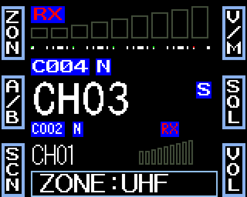
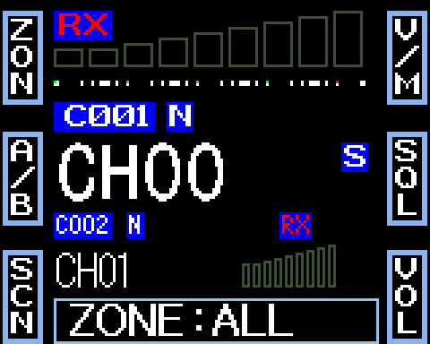
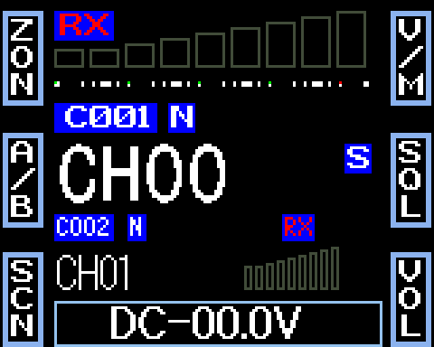

# What it does

Release 1.1.1 is the unmodified front-panel firmware plus the changes below: the version line, zones, and channel descriptions
with a new single-watch layout. 1.1.1 fixes the radio's own menus freezing the screen and keys on 1.1.0. Everything else
is as the maker made it.

Each feature adds a row to this table in the release that ships it, and the row says how far it has been checked.

| Feature | What you see | Since | Checked on a radio |
|---|---|---|---|
| [Version on the power-on screen](#version-on-the-power-on-screen) | A small line along the bottom of the power-on screen: `MM9PDY-` and the firmware version | 1.0.0-rc.2 | Yes, on test builds of 1.0.0-rc.2 and 1.1.0 |
| [Zones](#zones) | Group your channels into up to 32 named zones in Codeplug Studio, then pick one with the key set to DIR (the radio shows ZON). The knob, mic Up and Down and scan stay inside the zone | 1.1.0 | Once, on a test build of 1.1.0 |
| [Channel descriptions](#channel-descriptions) | In single watch, a short description (up to 12 characters, the channel's Name in Studio) in amber under the channel name, with the zone name in sky blue above it. Dual watch is unchanged | 1.1.0 | Once, on a test build of 1.1.0 |

The vendor's own version text (what the official programming software and Codeplug Studio read from the radio) is not
changed. The release name appears separately, as `mm9pdy-` plus the version (shown in capitals on the power-on screen).

## Version on the power-on screen

**Checked on a radio**, on test builds that differ from this release only in the text of the line.

When the radio starts, the power-on screen shows its usual text (RETEVIS, or your own) and, in small letters along the
bottom, `MM9PDY-` followed by the firmware version. The line stays as long as the power-on screen does. The radio's
small text is capitals only, so it reads in capitals.

| Firmware | The line reads |
|---|---|
| A release | `MM9PDY-1.0.0` |
| A release candidate | `MM9PDY-1.0.0-RC.2` |
| A test build | `MM9PDY-G` followed by a code, such as `MM9PDY-G1A2B3C` |

Where to look: the power-on screen only. The radio has no version page of its own, and the maker's test screen (which
you reach by holding **FUNC** and pressing **P4**) keeps showing the maker's version text; do not use it to check this
feature. Everything else on every screen is as before.

## Zones

**Checked on a radio once**, on a test build of 1.1.0 (it differs from this release only in the version line).

**Known issues**, still open in 1.1.1: some zone names run past the end of the popup box and leave a few
pixels near the P6 label, and some flicker and are not drawn; switching zone stays on the channel you are on when it is
also in the new zone.

A zone is a named group of your channels, such as `LOCAL` or `UHF`. You make zones in Codeplug Studio (its MM9PDY
target writes them with the rest of your codeplug); the radio never edits them. A zone has 1 to 8 characters in its name,
and there can be up to 32 zones.

**Setting it up.** Give a key the function **DIR**: a P-key (in the official CPS, in Codeplug Studio, or in the radio's
MINI KEY menu) or a key on the keypad microphone (PA to PD, in the radio's HAND KEY menu). The radio then labels that key
**ZON**, and the popup it opens says **ZONE**. Codeplug Studio's MM9PDY target can set the key for you. The DIR item in the
radio's FUNC MENU is not changed: it still flips the screen.

*The popup shows the zone name; the key at the top left now reads ZON. Demo channels and zones, in dual watch.*

**Using it.**

1. Press the ZON key. The bottom line shows `ZONE:` and the name of the current zone (`ZONE:ALL` for all channels).
2. Turn the knob, or press the microphone's Up and Down keys. You step through **All channels**, then each zone that has at
   least one of its channels on the radio, and round again. The radio changes to a channel of the new zone: the one you are
   on if it belongs, else the one you last used in that zone, else the lowest.
   
3. Press **PUSH**, any other key, or wait a few seconds to leave the popup.

**What a zone changes.**

| | |
|---|---|
| Stepping | The knob and the microphone's Up and Down keys go only through the zone's channels. A zone with a single channel answers `ERROR` to a step |
| Scan | Scans the zone's channels that are also in the scan list. A zone with fewer than two of those answers `ERROR` at the scan key, as the radio does when too few channels are in the scan list |
| Typing a number | Typing a channel number on the microphone keypad still goes to that channel, in the zone or not. The next knob step goes back to the zone |
| Two sides | Side A and side B each keep their own zone. Swapping A and B, or a side change when you transmit in dual watch, keeps each side's zone |
| Switching off | The radio remembers each side's zone, and starts in it next time |
| VFO mode | The key does nothing in VFO mode |

**When something is not right.** The radio then behaves as it does without zones, with all channels:

- there are no zones, or the zone data is damaged;
- the radio's memory chip is too small for them (a radio with a 16 KiB chip keeps no zones);
- a zone's channels are all gone (the zone is not offered, and a side whose zone empties goes to All).

One damaged zone is left out; the others still work.

**Your codeplug.** The official CPS and CHIRP do not read or write zones and do not disturb them. Zones are matched by
channel number, so if you edit your channels with them, check your zones in Codeplug Studio afterwards.

## Channel descriptions

**Checked on a radio once**, on a test build of 1.1.0 (it differs from this release only in the version line).

Codeplug Studio's MM9PDY target can give each channel a short description, up to 12 characters, taken from the channel's
Name in Studio. The radio's own channel name (the one the official CPS and CHIRP edit) is not changed, so a call sign can
stay there and the description can say what the channel is.

**Single watch.** The main side is drawn where it sits in dual watch, and two lines go underneath it: the zone name in sky
blue, and the channel's description in amber. A channel with no description shows only the zone line. The description
appears a moment after you stop turning the knob, and when a scan pauses on a channel. In VFO mode neither line is shown.

**Dual watch** is unchanged: there is no room for either line. Zones still work on both sides.

**When the description is hidden.** If a channel has been changed since Studio wrote it (on the radio, or with the
official CPS or CHIRP), the radio no longer shows its description, so it never shows one that belongs to another channel.
Write the codeplug again from Studio to bring it back.
